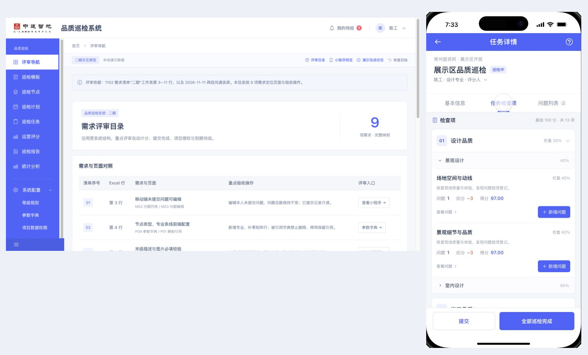

# 品质巡检二期 · 可点击原型

PC 管理端与小程序交互原型，覆盖二期需求清单中的 9 项需求，附页面设计与需求对照说明。

- [在线 PC 原型](https://li13146730115-creator.github.io/quality-inspection-phase2-prototype/#guide)
- [在线小程序原型](https://li13146730115-creator.github.io/quality-inspection-phase2-prototype/mobile/)
- [页面设计说明](页面设计说明.md)
- [使用说明与建议评审顺序](使用说明.md)
- [设计验收记录](design-qa.md)



## 演示

从 PC“评审导航”进入各项需求。建议依次查看模板配置、小程序巡检、专业完成汇总、运营评分及巡检报告。“演示完成状态”用于快速查看后续流程，“恢复初始”重置当前浏览器示例数据。

原型使用本地示例数据，无生产接口或真实消息发送。PC 和小程序在同一浏览器、同一网站下共享演示数据。上传图片保存在当前浏览器；业务待确认规则已在页面和设计说明中标注。

## 源码与本地运行

- `PC端/`：React + Vite 管理端。
- `移动端/`：React + TypeScript 小程序原型及设备模拟运行壳。
- `docs/`：GitHub Pages 静态发布目录。

需 Node.js 22.12+ 和 npm。首次使用分别在“PC端”和“移动端”执行 `npm ci`，在仓库根目录运行：

```sh
node 构建交付.mjs
python3 启动原型.py
```

浏览器访问 `http://localhost:4173/`，移动端为 `http://localhost:4173/mobile/`。

## 更新 GitHub Pages

```sh
node 构建交付.mjs --base=/quality-inspection-phase2-prototype/
```

将 `PC端/dist/client/` 的构建结果完整替换 `docs/`，并保留 `docs/.nojekyll`。提交到 `main` 后，由 GitHub Pages 从 `main /docs` 发布。在线更新后刷新浏览器即可查看。

验证命令：

```sh
node --test PC端/tests/domain.test.mjs
npm --prefix 移动端 run check:runtime
```

仓库包含原型源码、构建结果及设计说明；需求原表、沟通视频和自动转写材料保留在本地项目资料中。
